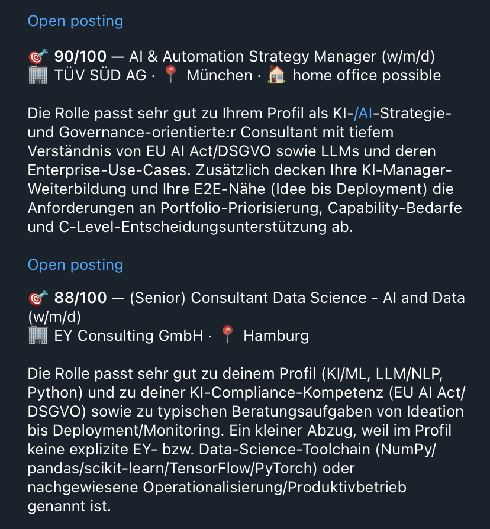
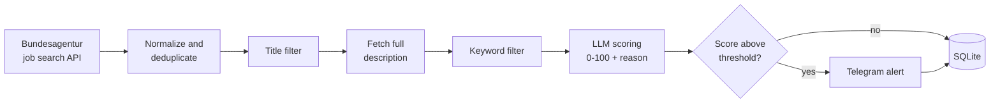

# Job Assistant

[](https://github.com/Wittmann9/job-assistant/actions/workflows/job-assistant.yml)

A personalised job search assistant. It pulls new listings from the German Federal Employment Agency (Bundesagentur für Arbeit), filters them, lets an LLM score each one against my own profile, and sends the best matches to me on Telegram. It runs on a schedule with GitHub Actions, so no server is needed.



## Why I built it

Job boards return hundreds of loosely related listings, and the ones that matter are easy to miss. I wanted an assistant that knows what I am looking for (roles, location, on-site preference, what should score low), reads the full job text, explains its score in two sentences, and only interrupts me when a match is strong.

## How it works



1. **Fetch:** one search per target job title and location (Bremen and Hamburg in my config), limited to recently published jobs.
2. **Deduplicate:** jobs already stored in SQLite are skipped, matched by ID and by company + title + location, because the same job is often posted more than once.
3. **Cheap filters first:** excluded words in the title drop a job immediately; only then is the full description loaded, and a whole-word keyword check removes unrelated jobs.
4. **LLM scoring:** the remaining jobs are scored against a free-text profile and return structured JSON (score, short reason, matched skills, red flags).
5. **Notify:** jobs above the threshold are sent to Telegram, best first, with a cap per run so a first run cannot flood the chat.

## Tech stack

- Python 3.12
- Bundesagentur job search service (public endpoint, no account needed)
- OpenAI API for scoring (the model is one constant in `scoring.py`)
- Telegram Bot API for notifications
- SQLite for state
- GitHub Actions for scheduling, with the database persisted between runs via the Actions cache

## Project structure

```
job-assistant/
├── main.py                  # pipeline and command line options
├── sources.py               # Bundesagentur search and job details
├── filters.py               # title and keyword filters
├── scoring.py               # LLM scoring
├── db.py                    # SQLite storage and deduplication
├── notify.py                # Telegram messages
├── profile.example.yaml     # example configuration
├── requirements.txt
└── .github/workflows/job-assistant.yml
```

## Run it locally

```bash
git clone https://github.com/Wittmann9/job-assistant.git
cd job-assistant
python -m venv .venv
source .venv/bin/activate
pip install -r requirements.txt
```

Create a `.env` file with your own credentials:

```
OPENAI_API_KEY=...
TELEGRAM_BOT_TOKEN=...
TELEGRAM_CHAT_ID=...
```

To get the Telegram values, create a bot with `@BotFather`, send your bot a message, and read your chat ID from `https://api.telegram.org/bot<TOKEN>/getUpdates`.

Create your profile from the example and edit it:

```bash
cp profile.example.yaml profile.yaml
```

Try it without sending anything:

```bash
python main.py --days 7 --limit 20 --dry-run
```

Then run it for real:

```bash
python main.py --days 7 --limit 20 --max-alerts 5
```

| Option | Meaning |
|---|---|
| `--days N` | only jobs published in the last N days |
| `--limit N` | score at most N new jobs per run |
| `--max-alerts N` | send at most N Telegram messages per run |
| `--dry-run` | score and store jobs, but do not send messages |

## Configuration

Everything personal lives in `profile.yaml`, so behaviour can be tuned without touching code.

| Key | Purpose |
|---|---|
| `target_roles` | job titles and keywords searched on the Bundesagentur (German and English) |
| `locations` | cities to search, with a 50 km radius |
| `relevance_keywords` | a job must mention at least one of these, as a whole word, to be scored |
| `exclude_keywords` | jobs with these words in the title are dropped immediately |
| `min_score_to_notify` | minimum LLM score (0-100) for an alert |
| `about_me` | free text the scorer reads: background, wanted roles, location, what should score low |
| `must_have_keywords`, `nice_to_have` | skills passed to the scorer as context |

`about_me` has the biggest effect on result quality. Being specific about what should score *low* helps as much as describing what should score high.

## Run it on a schedule (GitHub Actions)

The workflow in `.github/workflows/job-assistant.yml` runs several times a day and can also be started manually, with an optional dry-run switch.

1. Fork or clone the repository into your own account.
2. Under **Settings → Secrets and variables → Actions**, add these secrets:

   | Secret | Value |
   |---|---|
   | `OPENAI_API_KEY` | your OpenAI key |
   | `TELEGRAM_BOT_TOKEN` | your bot token |
   | `TELEGRAM_CHAT_ID` | your chat ID |
   | `PROFILE_YAML` | the full contents of your `profile.yaml` |

3. Open the **Actions** tab and run the workflow once with dry run enabled to check the setup.

Notes:

- The SQLite database is saved to the Actions cache after each run and restored at the start of the next one.
- The workflow sets `QUIET=1`, so job titles and scores never appear in logs. This matters because logs of public repositories are visible to everyone.
- Scheduled workflows in public repositories are paused after a period without repository activity. GitHub sends a warning, and any commit resets it.

## Design decisions

- **Cheap filters before the LLM.** Rules run first and the model only sees plausible jobs, which keeps cost low and the model focused.
- **Deduplication on two keys.** The ID catches repeats, and company + title + location catches the same job posted twice.
- **Failures are retried, not stored.** If loading a description or scoring fails, the job is not saved and is picked up again on the next run.
- **Flood protection.** A cap on jobs scored per run and on alerts sent per run keeps the first run, and any backlog, manageable.
- **Personal data stays out of the repository.** Credentials come from environment variables or secrets, the real profile is injected from a secret, and the repository only contains an example profile.
- **No scraping of job boards that forbid it.** Sources with a public interface are preferred. StepStone is deliberately not scraped, because of its terms of use and bot protection. Parsing job alert emails would be the cleaner way to add it.

## Limitations

- The Bundesagentur search service has no official documentation, so field names or paths can change and the code may need adjusting. It is a public endpoint used by the agency's own website.
- Only one source is implemented so far.
- Score quality depends on the profile text, and the model can be wrong. Treat scores as a ranking aid and read the posting before deciding.
- The first run after a cache loss treats old jobs as new, which the alert cap limits.
- There are no automated tests yet.

## Cost

Cost depends on the model and on how many jobs pass the filters. With a small model it is typically a few cents per day. Check your provider's usage page after the first day, and keep automatic recharge off while testing.

## Roadmap

- Save, Skip and Applied buttons on Telegram messages, and use that feedback to improve scoring
- `/saved` and `/stats` commands
- Unit tests for the filters
- More sources, such as company career feeds and job alert emails

## Disclaimer

This is a personal project. It is not affiliated with or endorsed by the Bundesagentur für Arbeit, OpenAI, or Telegram. Respect each service's terms of use and keep request volumes low.

## Author

Oxana Vitman · [LinkedIn](www.linkedin.com/in/oxana-vitman-a97b38217)

## License

MIT, see [LICENSE](LICENSE).
